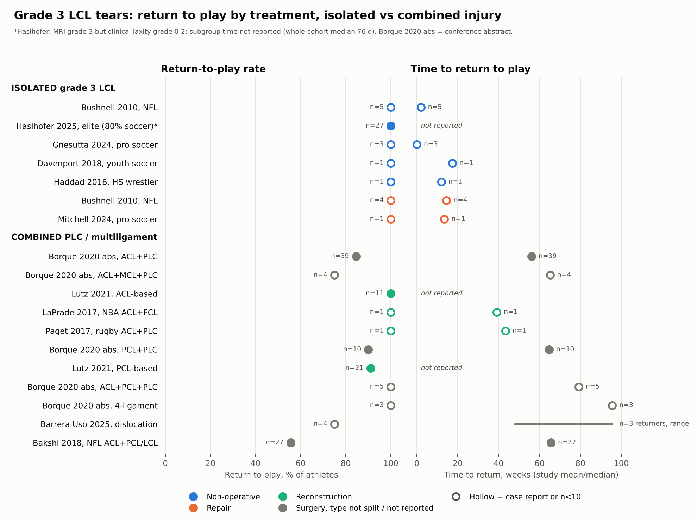

# Grade 3 LCL tears: return to play (RTP) evidence synthesis

> **Educational synthesis, not medical advice.** These numbers summarise small, mostly retrospective studies. Decisions about surgery or return to play for an individual belong to the treating surgeon and physiotherapist, who can examine the knee.

**Deliverable chosen: Option B (one figure).** 16 retrieved studies report RTP for grade 3 / complete LCL or PLC injuries. Ten of them are cohorts, systematic reviews or conference abstracts with usable quantitative RTP data, which clears the brief's ≥5 threshold.

**Caption.** Each dot is one study arm (n labelled). Filled dots are cohorts; hollow dots are case reports or subgroups with n<10. Colour shows treatment. The left panel is the share of athletes who returned to play; the right panel is the study's mean or median time to return. Isolated grade 3 tears returned in weeks whichever way they were treated, whereas in combined PLC/multiligament injuries the cohort means ran 56–96 weeks (two single-athlete case reports took 9–10 months), and fewer of those athletes reached their pre-injury level.

## First principles: why "isolated vs combined" dominates

The LCL is a single cord running from femur to fibula. Its job is to stop the knee gapping open on the outside when the shin is pushed inward (varus). A grade 3 tear means the cord is in complete discontinuity. On its own that is a one-structure problem: the popliteus, popliteofibular ligament and the cruciates still hold the knee, and the LCL sits outside the joint, where it can scar back together. In a combined injury the same tear is one part of a wrecked posterolateral corner, usually with a torn ACL or PCL. With several restraints gone at once, the knee is rotationally unstable, a cruciate graft gets overloaded, and reconstructing several structures pushes rehab out by months. The figure shows exactly this split.

## What the retrieved evidence says (numbers traced to `studies.csv` / `pooled_summary.csv`)

Pooled values are n-weighted, cohorts only; case reports are listed but never pooled.

| Group | Pooled RTP | Pooled RTP at same level | Time to RTP (range of study means/medians) | Evidence |
|---|---|---|---|---|
| **Isolated, non-operative** | 100% (n=5, flag n<10) | 100% (n=5) | 2.0 wk (Bushnell, NFL) | 1 study [1]; plus 4 case reports/series, 0–17.4 wk [4–6] |
| Isolated, non-operative, *MRI* grade 3 but clinical grade ≤2 | 100% (n=27) | 100% (n=27) | subgroup not reported | [2]; shown separately because these knees did not gap like a grade 3 on exam |
| **Isolated, repair** | 100% (n=4) | 100% (n=4) | 14.5 wk | 1 study [1]; plus pro-soccer case, 13.5 wk [7] |
| **Isolated, reconstruction** | — | — | — | **No RTP data retrieved** |
| Combined, surgical, ACL-based | 87.0% (n=54) | 65.1% (n=43) | 56.1–65.2 wk | [8,10] |
| Combined, surgical, PCL-based | 90.7% (n=31) | 90.0% (n=10) | 64.7 wk | [8,10] |
| Combined, surgical, bicruciate | 100% (n=8, flag n<10) | 62.5% (n=8) | 79.1–95.6 wk | [8] |
| Combined, NFL, treatment not reported | 55.6% (n=27) | 18.5% (n=27, prior performance) | 65.6 wk | [11] |
| Combined, repair vs reconstruction | — | 83.3% (n=18) vs 83.3% (n=24) | — | [12] |

**1. Isolated grade 3 LCL.** Every athlete in the retrieved isolated series returned. The only cohort pool for true isolated grade 3 non-operative care is just 5 NFL players [1]. In the one comparative cohort (NFL), non-operative players missed a mean of 2.0 weeks and repaired players 14.5 weeks [1]. The biggest caveat comes from the largest series [2]: 27 of its 55 elite athletes had a grade 3 tear on MRI, yet none of those 27 had grade 3 laxity on examination. MRI and clinical grade correlated poorly (r=0.37). So "grade 3 on MRI" mostly describes knees that are clinically grade ≤2. Good non-operative evidence for knees that gap grossly on varus stress (clinical grade 3) is essentially absent: one athlete in [2], plus case reports. Soccer/pivoting evidence: the 3 pro footballers kept playing without rest [6]; a youth footballer returned at about 4 months [5]; a repaired pro footballer played at 13.5 weeks [7]. No study reports RTP after isolated FCL **reconstruction**. The reconstruction series retrieved report scores and laxity only (side-to-side gapping 3.9 → −0.4 mm [24]).

**2. Combined PLC / multiligament.** RTP rates stay high in elite surgical series (87–91%), but return takes about 13–15 months, and fewer reach their old level [8,9]. ACL-based vs PCL-based: in elite athletes the RTP rates were similar (ACL+PLC 85%, PCL+PLC 90%) [8]. Borque 2022 also found PCL-based unicruciate injuries took longer (15.2 vs 11.9 months) [9]. In recreational patients, PCL-based injuries lost more activity (Tegner fell significantly, return to work 21 vs 11 weeks) [10]. Pivoting sports are where combined injuries really bite. In Lutz's study, soccer participation fell from 8 to 1 player (ACL-based) and from 7 to 2 (PCL-based), even though 100% and 91% "returned to sport" [10]. In the NFL, ACL + PCL/LCL injuries had 55.6% RTP and 18.5% return to prior performance, against 70.8% and 43.5% for ACL+MCL [11].

**3. Failure: repair vs reconstruction.** Every comparative source points the same way.

| Source | Repair failure | Reconstruction failure |
|---|---|---|
| Stannard [20] | 37.1% (13/35) | 9.1% (2/22) |
| Levy [21] | 40% (4/10) | 5.6% (1/18) |
| Fortier SR [16] | 21.9% (21/96) | 7.1% (6/84) |
| Geeslin SR [18] | 38% (17/45) | about 9% (other techniques) |
| White SR [17] (ranges) | 0–40% | 0–15% |

Two qualifications. Repair limited to *avulsion* patterns did better: 10.7% (3/28) [22], and 0 failures with repair-for-avulsion vs reconstruction-for-midsubstance [12]. In the same Fortier SR, RTS was 94% (48/51) after repair vs 100% (22/22) after reconstruction, which was not significant. The 2025 international consensus says isolated repair of grade III PLC tears should not be done without augmentation or reconstruction [28]. Re-injury after isolated non-op treatment was 1/55 at 42 months in [2]. No other study reported isolated re-injury.

**4. Decision thresholds.** The ~2.7 mm figure comes from a **cadaver** study. There, cutting the FCL raised clinician-applied varus-stress gapping by about 2.7 mm, and a full grade III PLC injury by about 4.0 mm [25]. Those are *diagnostic* thresholds. No retrieved clinical study validates 2.7 mm as a *surgical* cut-off. The ISAKOS 2021 algorithm that uses it could not be retrieved. Varus stress radiographs were slightly more sensitive than MRI for grade III FCL tears (70% vs 66%) [26]. On 0° vs 30°: Lutz reserved PLC reconstruction for varus laxity at *both* 0° and 30° plus a positive dial test [10], and Haslhofer graded laxity at 30° [2]. No retrieved study compares outcomes stratified by 0° vs 30° laxity.

**5. RTP clearance criteria.** Practice is mostly time-based. One protocol allowed pivoting sport at ≥9 months [10]. Permitted RTS after PLC reconstruction varied from 6.0 to 10.5 months depending on the weight-bearing protocol [19]. Online PLC rehab protocols disagree on RTS timing [31]. Criteria-based examples are case-level only: a time-independent, multi-phase return-to-performance pathway in pro soccer [7], and functional tests plus PROMs plus sport-specific tasks in a wrestler [4]. In pivoting-sport multiligament patients, hop and quadriceps-strength symmetry still lagged ACL-only patients at 6–12 months but matched them by 24 months [30]. That argues for objective strength/hop testing before clearance. No retrieved study validates a criteria set for LCL/PLC injuries.

**Open gaps:** isolated *clinical* grade 3 cohorts; RTP after isolated FCL reconstruction; soccer-specific combined-injury RTP; and validated, LCL-specific RTP criteria.

## Files

| File | Contents |
|---|---|
| `studies.csv` | One row per study arm. Blank = not reported; `pooling_role` says how each row was used. |
| `pooled_summary.csv` | Output of `analyze.py`. |
| `analyze.py` | Pooling + figure (`python analyze.py`). |
| `verify.py` | Re-checks every pooled/key number in this README against the CSVs. |
| `search.py`, `search_extra.py`, `citation_chase.py` | Literature API queries (PubMed, Europe PMC, OpenAlex, Semantic Scholar). |
| `search_log.md`, `search_hits.json` | Every query with hit counts, screening flow, exclusions and reasons. |

## References

Included studies:

1. Bushnell BD et al. Isolated grade III LCL injuries in NFL athletes. *Am J Sports Med* 2010;38(1):86-91. [doi:10.1177/0363546509344075](https://doi.org/10.1177/0363546509344075) · [PMID 19966106](https://pubmed.ncbi.nlm.nih.gov/19966106/)
2. Haslhofer DJ et al. Isolated clinically diagnosed grades 1-2 LCL injuries in elite athletes do not require surgery. *Orthop J Sports Med* 2025;13(12). [doi:10.1177/23259671251391357](https://doi.org/10.1177/23259671251391357) · [PMID 41341507](https://pubmed.ncbi.nlm.nih.gov/41341507/)
3. Sikka RS et al. Isolated fibular collateral ligament injuries in athletes. *Sports Med Arthrosc Rev* 2015;23(1):17-21. [doi:10.1097/JSA.0000000000000044](https://doi.org/10.1097/JSA.0000000000000044) · [PMID 25545646](https://pubmed.ncbi.nlm.nih.gov/25545646/)
4. Haddad MA et al. Conservative management of an isolated grade III LCL injury in an adolescent multi-sport athlete. *Int J Sports Phys Ther* 2016;11(4):596-606. [PMID 27525183](https://pubmed.ncbi.nlm.nih.gov/27525183/)
5. Davenport D et al. Non-operative management of an isolated LCL injury in an adolescent patient. *BMJ Case Rep* 2018. [doi:10.1136/bcr-2017-223478](https://doi.org/10.1136/bcr-2017-223478) · [PMID 29764846](https://pubmed.ncbi.nlm.nih.gov/29764846/)
6. Gnesutta A et al. Isolated distal grade III LCL injury in professional athletes. *Skeletal Radiol* 2024;53(5):983-987. [doi:10.1007/s00256-023-04463-9](https://doi.org/10.1007/s00256-023-04463-9) · [PMID 37782398](https://pubmed.ncbi.nlm.nih.gov/37782398/)
7. Mitchell A et al. Return-to-performance pathway after surgical repair of an isolated LCL rupture in a professional footballer. *Phys Ther Sport* 2024;70:116-126. [doi:10.1016/j.ptsp.2024.09.003](https://doi.org/10.1016/j.ptsp.2024.09.003) · [PMID 39499973](https://pubmed.ncbi.nlm.nih.gov/39499973/)
8. [Authors not listed in record.] Multi-ligament knee injuries in elite athletes: return to play rates, timing, and complications (conference abstract). *Orthop J Sports Med* 2020;8(7 suppl 6). [Europe PMC PMC7401073](https://europepmc.org/article/PMC/PMC7401073)
9. Borque KA et al. High return to play rate following treatment of multiple-ligament knee injuries in 136 elite athletes. *KSSTA* 2022;30(10):3393-3401. [doi:10.1007/s00167-022-06926-3](https://doi.org/10.1007/s00167-022-06926-3) · [PMID 35279739](https://pubmed.ncbi.nlm.nih.gov/35279739/)
10. Lutz PM et al. Combined posterolateral knee reconstruction: ACL-based injuries perform better compared to PCL-based injuries. *KSSTA* 2021;29(11):3846-3853. [doi:10.1007/s00167-020-06409-3](https://doi.org/10.1007/s00167-020-06409-3) · [PMID 33483769](https://pubmed.ncbi.nlm.nih.gov/33483769/)
11. Bakshi NK et al. Return to play after multiligament knee injuries in NFL athletes. *Sports Health* 2018;10(6):495-499. [doi:10.1177/1941738118768812](https://doi.org/10.1177/1941738118768812) · [PMID 29638200](https://pubmed.ncbi.nlm.nih.gov/29638200/)
12. Minator Sajjadi M et al. Repair and reconstruction of acute PLC injuries combined with cruciate injuries. *Arch Bone Jt Surg* 2022;10(4):339-346. [doi:10.22038/ABJS.2021.53118.2636](https://doi.org/10.22038/ABJS.2021.53118.2636) · [PMID 35721588](https://pubmed.ncbi.nlm.nih.gov/35721588/)
13. Barrera Uso M et al. Return to previous sport level in professional athletes after knee dislocations treated with single-stage reconstruction. *Orthop J Sports Med* 2025;13(5). [doi:10.1177/23259671251336777](https://doi.org/10.1177/23259671251336777) · [PMID 40416994](https://pubmed.ncbi.nlm.nih.gov/40416994/)
14. LaPrade RF et al. Return to NBA competition following ACL and FCL injuries: a case report. *JBJS Case Connect* 2017;7(4):e81. [doi:10.2106/JBJS.CC.17.00085](https://doi.org/10.2106/JBJS.CC.17.00085) · [PMID 29286965](https://pubmed.ncbi.nlm.nih.gov/29286965/)
15. Paget LDA et al. Fast-tracked rehabilitation and return to sport of an elite rugby player with a complicated PLC injury. *BMJ Case Rep* 2017. [doi:10.1136/bcr-2017-219666](https://doi.org/10.1136/bcr-2017-219666) · [PMID 29079672](https://pubmed.ncbi.nlm.nih.gov/29079672/)
16. Fortier LM et al. Higher success rate in reconstruction of acute PLC injuries vs repair: updated systematic review. *KSSTA* 2023;31(12):5565-5578. [doi:10.1007/s00167-023-07582-x](https://doi.org/10.1007/s00167-023-07582-x) · [PMID 37848567](https://pubmed.ncbi.nlm.nih.gov/37848567/)
17. White AE et al. Repair fails more frequently than reconstruction in acute PLC knee injuries: a systematic review. *Arthroscopy* 2025;41(8):3223-3240.e8. [doi:10.1016/j.arthro.2024.11.093](https://doi.org/10.1016/j.arthro.2024.11.093) · [PMID 39672245](https://pubmed.ncbi.nlm.nih.gov/39672245/)
18. Geeslin AG et al. Systematic review of outcomes of PLC knee injuries, part 1: surgical treatment of acute injuries. *Am J Sports Med* 2016;44(5):1336-42. [doi:10.1177/0363546515592828](https://doi.org/10.1177/0363546515592828) · [PMID 26260464](https://pubmed.ncbi.nlm.nih.gov/26260464/)
19. Morris BL et al. Weightbearing protocols after PLC reconstruction: a systematic review. *Orthop J Sports Med* 2021;9(3). [doi:10.1177/2325967120988274](https://doi.org/10.1177/2325967120988274) · [PMID 33796586](https://pubmed.ncbi.nlm.nih.gov/33796586/)
20. Stannard JP et al. The posterolateral corner of the knee: repair versus reconstruction. *Am J Sports Med* 2005;33(6):881-8. [doi:10.1177/0363546504271208](https://doi.org/10.1177/0363546504271208) · [PMID 15827360](https://pubmed.ncbi.nlm.nih.gov/15827360/)
21. Levy BA et al. Repair versus reconstruction of the FCL and PLC in the multiligament-injured knee. *Am J Sports Med* 2010;38(4):804-9. [doi:10.1177/0363546509352459](https://doi.org/10.1177/0363546509352459) · [PMID 20118498](https://pubmed.ncbi.nlm.nih.gov/20118498/)
22. Moran J et al. Repair of acute grade 3 combined PLC avulsion injuries using an enhanced fixation technique. *Orthop J Sports Med* 2022;10(11). [doi:10.1177/23259671221131817](https://doi.org/10.1177/23259671221131817) · [PMID 36389620](https://pubmed.ncbi.nlm.nih.gov/36389620/)
23. Geeslin AG et al. Outcomes of treatment of acute grade-III isolated and combined posterolateral knee injuries. *J Bone Joint Surg Am* 2011;93(18):1672-83. [doi:10.2106/JBJS.J.01639](https://doi.org/10.2106/JBJS.J.01639) · [PMID 21938371](https://pubmed.ncbi.nlm.nih.gov/21938371/)
24. LaPrade RF et al. Fibular collateral ligament anatomical reconstructions: a prospective outcomes study. *Am J Sports Med* 2010;38(10):2005-11. [doi:10.1177/0363546510370200](https://doi.org/10.1177/0363546510370200) · [PMID 20595544](https://pubmed.ncbi.nlm.nih.gov/20595544/)

Context (thresholds, consensus, rehab):

25. LaPrade RF et al. Reproducibility and repeatability of varus stress radiographs (in vitro biomechanical study). *J Bone Joint Surg Am* 2008;90(10):2069-76. [doi:10.2106/JBJS.G.00979](https://doi.org/10.2106/JBJS.G.00979) · [PMID 18829903](https://pubmed.ncbi.nlm.nih.gov/18829903/)
26. Kane PW et al. Increased accuracy of varus stress radiographs vs MRI in diagnosing FCL grade III tears. *Arthroscopy* 2018;34(7):2230-2235. [doi:10.1016/j.arthro.2018.03.029](https://doi.org/10.1016/j.arthro.2018.03.029) · [PMID 29884567](https://pubmed.ncbi.nlm.nih.gov/29884567/)
27. Chahla J et al. Posterolateral corner of the knee: an expert consensus statement. *KSSTA* 2019;27(8):2520-2529. [doi:10.1007/s00167-018-5260-4](https://doi.org/10.1007/s00167-018-5260-4) · [PMID 30478468](https://pubmed.ncbi.nlm.nih.gov/30478468/)
28. LaPrade RF et al. Contemporary international expert consensus statement on PLC injuries. *Arthroscopy* 2025;41(11):4630-4640. [doi:10.1016/j.arthro.2025.04.055](https://doi.org/10.1016/j.arthro.2025.04.055) · [PMID 40414466](https://pubmed.ncbi.nlm.nih.gov/40414466/)
29. Grawe B et al. Lateral collateral ligament injury about the knee: anatomy, evaluation, and management. *J Am Acad Orthop Surg* 2018;26(6):e120-e127. [doi:10.5435/JAAOS-D-16-00028](https://doi.org/10.5435/JAAOS-D-16-00028) · [PMID 29443704](https://pubmed.ncbi.nlm.nih.gov/29443704/)
30. Ebert JR et al. Multiligament reconstruction after pivoting-sport injury vs ACL reconstruction: outcomes to 2 years. *KSSTA* 2025;33(3):865-877. [doi:10.1002/ksa.12409](https://doi.org/10.1002/ksa.12409) · [PMID 39101299](https://pubmed.ncbi.nlm.nih.gov/39101299/)
31. Mitchnik IY et al. Disagreement persists on rehabilitation goals and timelines after PLC reconstruction. *Arthrosc Sports Med Rehabil* 2025;7(3):101142. [doi:10.1016/j.asmr.2025.101142](https://doi.org/10.1016/j.asmr.2025.101142) · [PMID 40692928](https://pubmed.ncbi.nlm.nih.gov/40692928/)

Not retrievable via the APIs and therefore **not used**: the ISAKOS 2021 ePoster 14413 and the Aspetar "Isolated FCL injury in professional football" article (see `search_log.md`).

---
*Educational synthesis only. Not medical advice; individual RTP decisions belong to the treating surgeon and physiotherapist.*
